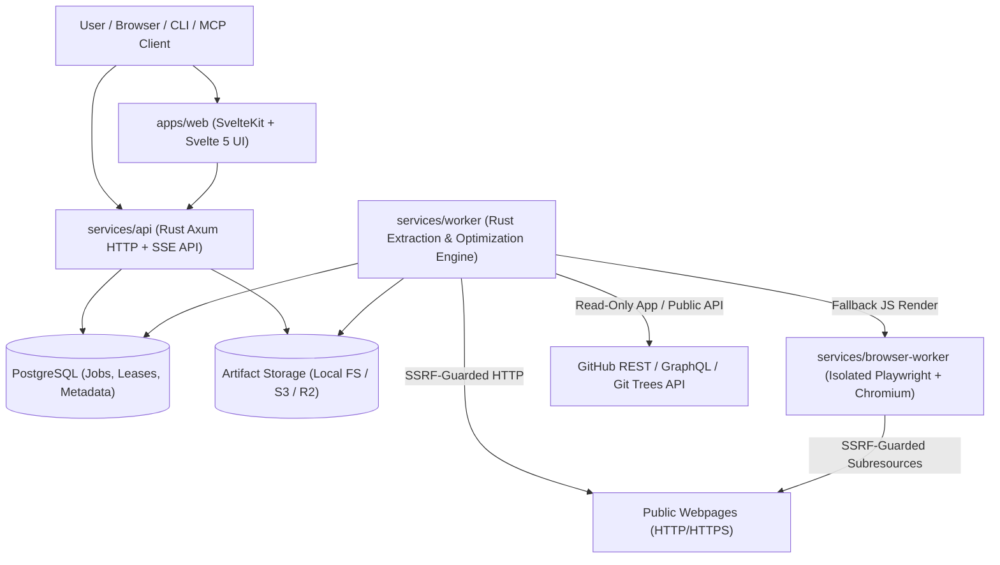

# System Architecture (`docs/ARCHITECTURE.md`)

**Project:** `web-repo-to-ai`  
**Status:** Baseline Architecture v1.0

---

## 1. High-Level Topology



---

## 2. Component Responsibilities & Dependency Rules

### 2.1 Frontend (`apps/web`)
- Built with **SvelteKit**, **Svelte 5** runes, **TypeScript**, and **Tailwind CSS**.
- Communicates exclusively with `services/api` via JSON REST endpoints and Server-Sent Events (SSE) for real-time job progress.
- Never stores or handles raw GitHub App private keys or database credentials.

### 2.2 HTTP API Service (`services/api`)
- Built with **Axum** and **Tokio**.
- Responsibilities: request schema validation, URL pre-validation, GitHub App OAuth/installation callback handling, job creation, job status queries, SSE progress streaming, rate limiting, and streaming artifact downloads.
- Never runs heavy HTML/code extraction or synchronous tree-sitter compilation on request threads.

### 2.3 Processing Worker (`services/worker`)
- Asynchronous background service polling/leasing jobs from PostgreSQL via `crates/job-engine`.
- Executes the multi-stage pipeline:
  1. **Acquisition** (`crates/url-security`, `crates/web-extractor`, `crates/github-extractor`)
  2. **Parsing & Intelligence** (`crates/code-intelligence`, `crates/normalizer`)
  3. **Canonicalization** (`crates/cdm`)
  4. **Optimization & Tokenization** (`crates/deduplication`, `crates/tokenizer`, `crates/context-optimizer`, `crates/chunking`)
  5. **Export & Integrity Verification** (`crates/exporters`, `crates/storage`)

### 2.4 Isolated Browser Worker (`services/browser-worker`)
- Containerized service running Playwright + Chromium with strict resource caps, navigation timeouts, disabled file:// access, and request interception blocking private/loopback IP ranges.

---

## 3. Shared Rust Workspace Crate Graph

```text
observability ──┐
core ───────────┼──► cdm ──► normalizer ──► deduplication ──► tokenizer ──► context-optimizer ──► chunking ──► exporters
url-security ───┘     ▲           ▲                                                                               │
      │               │           │                                                                               ▼
      ├──► web-extractor          ├──► code-intelligence                                                       storage
      └──► github-extractor ──────┘                                                                               │
                                                                                                                  ▼
                                                                                                              job-engine
```

| Crate | Purpose |
| :--- | :--- |
| `crates/core` | Domain IDs, configuration loader, unified error taxonomy, and shared traits. |
| `crates/cdm` | Versioned Canonical Context Document Model (`v1.0`), validation, and migrations. |
| `crates/url-security` | URL normalization, DNS resolution, IP range blocking, and redirect revalidation. |
| `crates/web-extractor` | Static HTML (`html5ever`/`scraper`), readability, docs layout, and browser-worker client. |
| `crates/github-extractor` | GitHub REST/GraphQL/Git Trees acquisition, subtree recovery, and completeness manifest. |
| `crates/code-intelligence` | `tree-sitter` AST parsing, symbol extraction, and import/architecture relationship mapping. |
| `crates/normalizer` | Whitespace, encoding, table, and code-block normalization without semantic loss. |
| `crates/deduplication` | Exact `BLAKE3` content hashing and near-duplicate section consolidation. |
| `crates/tokenizer` | Exact BPE tokenizers and explicitly labeled heuristic estimators with uncertainty bounds. |
| `crates/context-optimizer` | Context profile transformations and token-budget prioritization. |
| `crates/chunking` | Deterministic AST- and heading-aware chunking with configurable overlap. |
| `crates/exporters` | Markdown, TXT, JSON, HTML, JSONL, and streaming ZIP archive generators. |
| `crates/storage` | Content-addressed blob cache and artifact storage (`LocalFsStorage`, `S3CompatibleStorage`). |
| `crates/job-engine` | PostgreSQL state machine, lease acquisition, heartbeats, and crash recovery. |
| `crates/observability` | Structured `tracing` subscribers, secret-redacting formatters, and metrics. |
