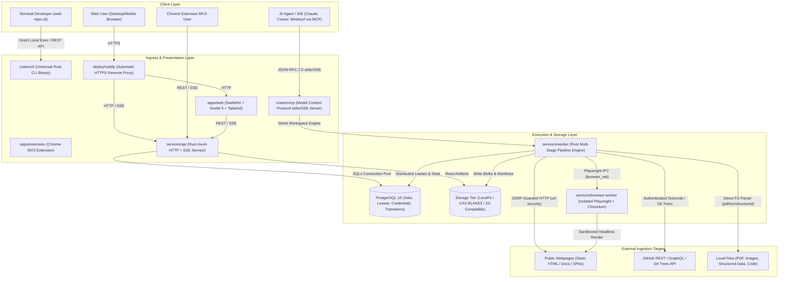
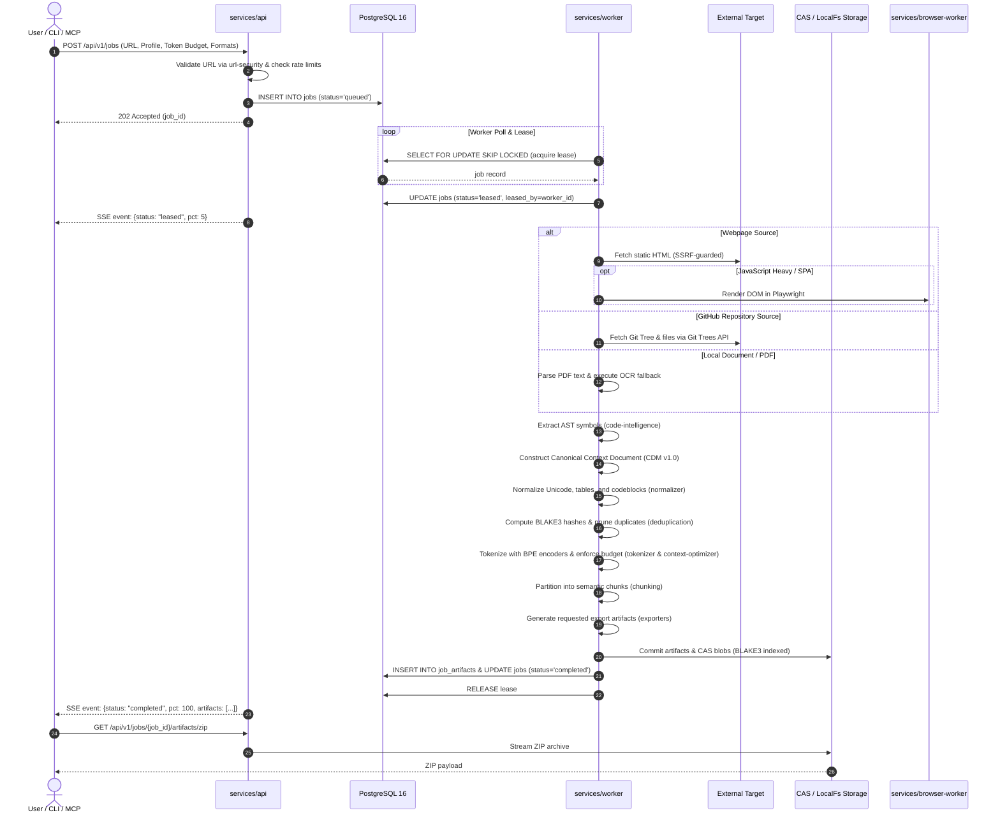

# System Architecture (`docs/ARCHITECTURE.md`)

**Project:** `web-repo-to-ai`  
**Status:** Certified Architecture v1.0  
**Scope:** Universal URL & GitHub Repository → AI-Ready Content Converter Monorepo

---

## 1. High-Level Topology

`web-repo-to-ai` is structured as a resilient, security-hardened, modular monorepo comprising **21 Rust crates**, **3 containerized services**, and **2 frontends (Web application and Chrome Extension)**. The platform ingests arbitrary public/authenticated web pages, GitHub repositories, PDFs, and structured data, producing deterministic, normalized, token-optimized Canonical Context Documents (CDM) tailored for Large Language Models (LLMs) and RAG vector databases.



---

## 2. Component Responsibilities & Boundaries

The monorepo contains 26 primary components divided across four architectural domains:

### 2.1 Frontends & Clients
1. **`apps/web` (Web Application):**
   - Built with **SvelteKit**, **Svelte 5** runes (`$state`, `$derived`, `$effect`), TypeScript, and Tailwind CSS.
   - Responsibilities: Conversion configuration wizard, token-budget calculator, real-time SSE progress streaming, Monaco-powered document diff viewer, and multi-format artifact downloader.
   - Non-Negotiable Boundary: Never handles raw GitHub App private keys or database connection strings.
2. **`apps/extension` (Chrome Extension MV3):**
   - Built with TypeScript and Manifest V3 specifications.
   - Responsibilities: One-click active tab extraction, DOM tree snapshotting, selection scraping, local CDM preview, and direct submission to the backend API or local MCP server.
3. **`crates/cli` (Universal Command-Line Interface):**
   - Built with `clap` (derive parser).
   - Responsibilities: Standalone and client-mode URL conversion (`web-repo-cli url`), repository conversion (`web-repo-cli repo`), batch processing (`web-repo-cli batch`), configuration management, and shell completions.
4. **`crates/mcp` (Model Context Protocol Server):**
   - Built on JSON-RPC 2.0 protocol over `stdio` and HTTP/SSE transports.
   - Responsibilities: Exposes conversion tools (`convert_url`, `convert_repository`, `query_job_status`, `estimate_tokens`) and dynamic resources (`cdm://`, `token-map://`) to agentic IDEs (Claude Desktop, Cursor, Antigravity, Windsurf).

### 2.2 Network Services
1. **`services/api` (REST & SSE HTTP Service):**
   - Built with **Axum**, **Tower**, and **Tokio**.
   - Responsibilities: Ingress request validation, URL pre-screening, GitHub App OAuth and installation token exchange, job lifecycle management, SSE progress broadcasting, and streaming artifact distribution.
   - Boundary: Never performs heavy AST parsing, OCR, or synchronous rendering on the HTTP request thread.
2. **`services/worker` (Pipeline Execution Engine):**
   - Background Tokio daemon running concurrent pipeline workers.
   - Responsibilities: Distributed job leasing via PostgreSQL, multi-stage conversion execution, AIMD adaptive concurrency regulation, CAS storage writing, and graceful teardown.
3. **`services/browser-worker` (Sandboxed Headless Browser):**
   - Node.js Playwright + Chromium service running in a locked-down container.
   - Responsibilities: JavaScript rendering fallback for dynamic Single Page Applications (SPAs), automated cookie consent bypassing, and network request interception.
   - Boundary: Isolated on the `browser_net` bridge network with no connectivity to PostgreSQL or internal administrative ports.

### 2.3 Shared Core & Ingestion Crates
1. **`crates/core`:** Foundational domain identifiers (`DocumentId`, `JobId`), configuration schemas, unified error taxonomy (`CdmError`), and common traits.
2. **`crates/cdm`:** Canonical Context Document Model (CDM v1.0.0) data types, hierarchical outlines, section models, and validation logic.
3. **`crates/url-security`:** Defense-in-depth URL validation, DNS re-resolution, RFC 1918/6598 private IP range blocking, and redirect tracking.
4. **`crates/web-extractor`:** Fast static HTML acquisition (`reqwest`), HTML parsing (`html5ever`/`scraper`), readability extraction, metadata harvesting, and browser-worker client.
5. **`crates/github-extractor`:** GitHub REST and GraphQL API client, Git Trees recursive traversal, subtree recovery, rate limit backoff, and completeness manifest calculation.
6. **`crates/pdf-extractor`:** Portable Document Format text extraction, font and structural layout analysis, table boundary detection, and OCR fallback delegation.
7. **`crates/ocr-extractor`:** Local optical character recognition wrapper (Tesseract/native), image preprocessing, orientation deskewing, and bounding-box text assembly.
8. **`crates/structured-extractor`:** Tabular and structured schema extractor for JSON, YAML, TOML, CSV, TSV, and XML documents.
9. **`crates/code-intelligence`:** Multi-language syntax parsing using `tree-sitter`, symbol extraction, function/class outline generation, and import graph mapping.

### 2.4 Optimization, Storage & Observability Crates
1. **`crates/normalizer`:** Lossless text normalization, Unicode NFKC cleaning, smart quote sanitization, Markdown table alignment, and code block formatting.
2. **`crates/deduplication`:** Exact BLAKE3 content hashing, sliding-window section deduplication, and duplication metrics.
3. **`crates/tokenizer`:** High-performance BPE tokenizers (`cl100k_base`, `o200k_base`, `p50k_base`, `llama3`) and heuristic estimators with calibrated uncertainty intervals.
4. **`crates/context-optimizer`:** Context profile execution (Full, Summary, Code-only, Architecture, RAG), token-budget prioritization, and importance ranking.
5. **`crates/chunking`:** Deterministic heading- and AST-aware semantic chunking with configurable overlap and token bounds.
6. **`crates/ai-adapter`:** Direct Large Language Model integration, prompt synthesis, local zero-key fallback models, and streaming generation.
7. **`crates/exporters`:** Multi-format output generation: Markdown, Plaintext, CDM JSON, Structured HTML, JSONL, XML, RAG Vector schemas (Qdrant, Pinecone, ChromaDB, Weaviate, Milvus), and streaming ZIP bundles.
8. **`crates/storage`:** Dual-tier Content-Addressable Storage (CAS) with BLAKE3 verification, LRU cache eviction, local filesystem driver (`LocalFsStorage`), and S3-compatible cloud driver.
9. **`crates/job-engine`:** Relational PostgreSQL state machine, pessimistic distributed leasing, heartbeat telemetry, dead-letter transitions, and AIMD backpressure queues.
10. **`crates/observability`:** Structured `tracing` logging, secret-redacting formatters, Prometheus metric registries, and OpenTelemetry instrumentation.

---

## 3. Crate Dependency Graph

The Rust workspace strictly enforces a unidirectional, acyclic dependency graph. Domain types flow from `core` and `cdm` outward to specialized extractors, optimizers, and service hosts:

```text
                                crates/core
                                     │
                 ┌───────────────────┼───────────────────┐
                 ▼                   ▼                   ▼
          crates/observability crates/url-security  crates/cdm
                 │                   │                   │
                 │         ┌─────────┴─────────┐         │
                 │         ▼                   ▼         │
                 │   web-extractor      github-extractor │
                 │         │                   │         │
                 │         ├─────────┬─────────┤         │
                 │         ▼         ▼         ▼         │
                 │    pdf-extractor  ocr   structured    │
                 │         │         │         │         │
                 │         └─────────┼─────────┘         │
                 │                   ▼                   │
                 │          code-intelligence            │
                 │                   │                   │
                 └───────────────────┼───────────────────┘
                                     ▼
                              crates/normalizer
                                     │
                                     ▼
                            crates/deduplication
                                     │
                                     ▼
                              crates/tokenizer
                                     │
                                     ▼
                          crates/context-optimizer
                                     │
                                     ▼
                              crates/chunking
                                     │
                                     ▼
                             crates/ai-adapter
                                     │
                                     ▼
                              crates/exporters
                                     │
                         ┌───────────┴───────────┐
                         ▼                       ▼
                  crates/storage         crates/job-engine
                         │                       │
                         └───────────┬───────────┘
                                     ▼
              ┌──────────────────────┼──────────────────────┐
              ▼                      ▼                      ▼
         crates/cli             crates/mcp            services/api
                                                            │
                                                            ▼
                                                     services/worker
```

---

## 4. End-to-End Ingestion & Processing Data Flow

Every conversion follows a deterministic, 7-stage pipeline:



---

## 5. Storage Architecture & Content-Addressable Caching

The storage subsystem (`crates/storage`) is engineered for high throughput, data integrity, and strict storage ceiling compliance:

1. **Dual Storage Engines:**
   - `LocalFsStorage`: Atomic file persistence using temporary staging scratch files (`.artifact.tmp.*`) and atomic renames to prevent partial reads.
   - `S3CompatibleStorage`: Cloud object storage driver supporting AWS S3, Cloudflare R2, and MinIO with streaming uploads.
2. **Content-Addressable Storage (CAS):**
   - Every file blob is indexed by its raw `BLAKE3` cryptographic hash (`cas/ab/cd/abcdef...`).
   - Identical files across different repositories or web crawl pages are stored exactly once ($O(1)$ disk growth).
3. **Storage Ceiling & Proactive Eviction:**
   - Bounded by a strict workstation ceiling ($\le 30$ GB Podman / local quota).
   - Atomic LRU cache prunes expired staging artifacts and unreferenced CAS blobs when disk usage exceeds the 80% watermark (24 GB).
   - Automated CAS integrity audits (`CasAuditReport`) verify 100% indexed blob hashes and purge corrupted blocks.

---

## 6. Resilience, Concurrency & Fault Tolerance

The worker execution engine incorporates carrier-grade distributed systems patterns:

1. **Distributed Pessimistic Leasing:**
   - Workers lease jobs using `SELECT ... FOR UPDATE SKIP LOCKED` with explicit expiration timeouts (default 300 seconds).
   - In-flight worker heartbeats periodically extend leases. If a worker node crashes or hangs, the heartbeat expires and peer workers safely reclaim the task.
2. **Adaptive Concurrency Control (AIMD):**
   - Worker concurrency dynamically throttles based on target response signals.
   - Upon encountering HTTP 429 (Rate Limit) or server errors, concurrency additively decreases ($8 \to 4 \to 2$ floor).
   - Upon sustained healthy conversions, concurrency smoothly scales back up additively.
3. **Watermark Flow Control & Backpressure:**
   - In-memory task queues implement dual watermarks (High = 4, Low = 2, Capacity = 6).
   - Excess submissions trigger immediate non-blocking backpressure rejections (`BackpressureQueueSaturated`), protecting system memory.
4. **Cooperative Shutdown & Scratch Draining:**
   - Worker traps `SIGINT` / `SIGTERM` signals, transitions to `is_shutting_down = true`, stops leasing new jobs, waits for in-flight tasks to flush, and cleanly drains temporary staging scratch files.

---

## 7. Security Architecture & Boundary Invariants

Security is enforced at every layer in accordance with `docs/SECURITY.md`:

| Security Layer | Enforcing Component | Mechanism |
| :--- | :--- | :--- |
| **Ingress SSRF Defense** | `crates/url-security` | Pre-flight DNS resolution, private/loopback IP range validation (RFC 1918, RFC 6598, link-local, loopback), and strict post-redirect revalidation. |
| **Credential Protection** | `services/api` & PostgreSQL | GitHub App tokens and installation keys are encrypted at rest using `AES-256-GCM` with cryptographic nonces. Never logged. |
| **Log Sanitization** | `crates/observability` | Custom regex redaction layer in `tracing` strips Bearer tokens, GitHub private keys, and passwords before output. |
| **Browser Isolation** | `services/browser-worker` | Headless Chromium runs in an unprivileged container (`pwuser`, UID 1000) on an isolated internal network (`browser_net`) with `file://` scheme disabled. |
| **Payload Guardrails** | `services/api` & `crates/cdm` | Strict HTTP payload limits (JSON $\le 64$ KiB, file uploads $\le 100$ MB) preventing memory exhaustion attacks. |
