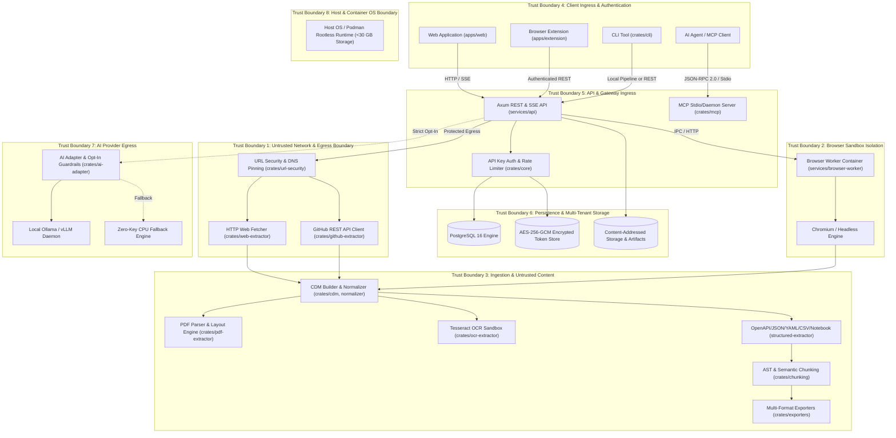
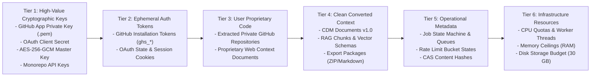
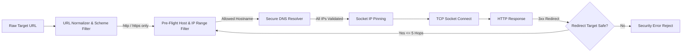
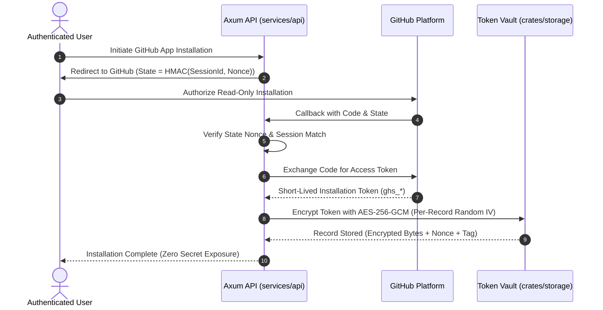

# Security Architecture & Threat Model (`docs/SECURITY.md`)

**Project:** `web-repo-to-ai` (Universal URL & GitHub Repository → AI-Ready Content Converter)  
**Classification:** Official Security Architecture Specification & Production Threat Model  
**Version:** 2.0 (Stage 11 Production Certification)  
**Status:** Certified Active Specification  

---

## 1. Executive Summary & Security Philosophy

`web-repo-to-ai` is designed to ingest arbitrary public URLs, web documentation trees, and private GitHub repositories, converting them into structured, high-fidelity AI-ready context packages (Markdown, TXT, JSON, HTML, JSONL, and ZIP packages). By nature of its core mission, the system operates in a high-risk operational domain: it directly downloads, parses, processes, and serializes untrusted external content while managing sensitive user authorization credentials (GitHub App tokens, API keys).

To protect users, host infrastructure, and downstream Large Language Models (LLMs), the architecture adopts five foundational security tenets:

1. **Zero Trust Egress & Mandatory SSRF Immunization:** Outbound network requests cannot access private IP spaces, cloud metadata services, internal services, or local daemon ports under any circumstances. DNS rebinding and redirect hopping are actively defeated at the socket connection layer.
2. **Zero Code Execution Guarantee:** Target repository code, build scripts, macros, Makefiles, package manifests, and dynamic web scripts are strictly treated as inert data and never executed.
3. **Defense-in-Depth Isolation:** Browser rendering executes within dedicated unprivileged containers without access to storage credentials. AI inference is 100% opt-in with complete zero-key fallback. Multi-tenant storage enforces cryptographically isolated tenant boundaries and anti-enumeration.
4. **Least Privilege & Envelope Encryption:** Private GitHub access requires minimal read-only permissions (`Contents: Read-only`, `Metadata: Read-only`). All sensitive tokens are encrypted at rest using authenticated `AES-256-GCM` with per-record random nonces.
5. **Lossless Source Integrity with Delimited LLM Framing:** Content extracted from untrusted repositories is wrapped in unambiguous structural boundaries and provenance headers to prevent prompt injection and instruct downstream models to isolate code from system instructions.

---

## 2. System Topology & Architectural Trust Boundaries

The system architecture and data flow span eight distinct trust boundaries:



### Detailed Trust Boundary Definitions

| Boundary ID | Boundary Name | Outside (Untrusted) | Inside (Trusted) | Primary Enforcement Mechanism |
| :--- | :--- | :--- | :--- | :--- |
| **TB-1** | Untrusted Public Network & Egress | Public Web, malicious DNS, cloud metadata, RFC 1918 internal IPs | Monorepo HTTP clients (`web-extractor`, `github-extractor`) | `crates/url-security`: Pre-connect DNS pinning, strict IP range blocklist, manual redirect revalidation |
| **TB-2** | Browser Sandbox Isolation | Untrusted JavaScript, malformed DOMs, malicious subresources | Core backend and database services | `services/browser-worker`: Dedicated rootless container, no DB/token access, Playwright route interception |
| **TB-3** | Ingestion & Untrusted Content | Extracted source files, PDF binaries, CSV, Jupyter notebooks, YAML | Canonical Context Document Model (CDM) | Pure static parsing (`lopdf`, `tree-sitter`, `html5ever`), zero code execution, memory ceilings, decompression bomb limits |
| **TB-4** | Client Ingress & Authentication | Unauthenticated web visitors, malicious API callers, rogue MCP messages | Axum route handlers & MCP dispatchers | `services/api`: Cryptographic API keys (`wr_live_*`), Blake3 hashing, scoped RBAC, token-bucket rate limiting |
| **TB-5** | GitHub OAuth & Credential Authority | GitHub OAuth redirect callbacks, stolen bearer tokens, user impersonation | GitHub App installation token cache & worker dispatcher | `crates/github-extractor`: Cryptographic CSRF state validation, strictly read-only scopes, short-lived tokens |
| **TB-6** | Persistence & Multi-Tenant Storage | Cross-tenant queries, IDOR attacks, disk tampering | PostgreSQL schema, CAS storage directory | `crates/storage`: Tenant ID binding on every query, anti-enumeration 404s, `AES-256-GCM` encryption at rest |
| **TB-7** | AI Provider & External Gateway | Remote LLM endpoints, prompt leaks, token leakage in logs | Context generation pipeline | `crates/ai-adapter`: Disabled by default, `LocalOnly` policy enforcement, secret scrubbing, zero-key CPU fallback |
| **TB-8** | Host & Container OS Boundary | Container breakout, disk fill attacks, process runaway | Workstation host OS, developer environment | Rootless Podman containers, non-root users (`uid: 10001`), hard 30 GB disk ceiling scripts, `kill_on_drop(true)` |

---

## 3. Asset Inventory & Data Classification

The system manages six distinct tiers of sensitive assets, prioritized by business impact in the event of compromise:



### Asset Sensitivity & Security Objectives

| Asset Tier | Data Description | Confidentiality | Integrity | Availability | Primary Protective Controls |
| :--- | :--- | :---: | :---: | :---: | :--- |
| **Tier 1: Master Keys** | GitHub App private `.pem`, OAuth client secret, `AES-256-GCM` encryption key, API keys (`wr_live_*`) | **CRITICAL** | **CRITICAL** | High | Environment isolation, Blake3 hashing, memory-only key derivation, zero persistence of unencrypted keys |
| **Tier 2: Ephemeral Tokens** | GitHub App installation tokens (`ghs_*`), user session cookies, CSRF tokens | **CRITICAL** | High | High | `AES-256-GCM` encryption at rest, automatic secret masking in logs, short expiration (1 hour), auto-revocation |
| **Tier 3: User Source Code** | Source code, configuration files, and architectural designs extracted from private repositories | **HIGH** | **CRITICAL** | High | Strict tenant isolation, anti-enumeration, ephemeral worker scratch directories, zero code execution |
| **Tier 4: Converted Context** | CDM v1.0 documents, Markdown exports, vector chunks, OCR text, PDF layouts | Moderate | **CRITICAL** | High | Blake3 checksum verification, structural prompt framing, lossless formatting, CAS content addressing |
| **Tier 5: Operational Data** | Job state transitions, rate limit counters, HTTP cache headers, audit logs | Low | High | High | PostgreSQL transactional isolation, atomic Redis/in-memory rate limiters, secret-redacted logging subscriber |
| **Tier 6: Compute Resources** | Host CPU, RAM, disk space, network sockets, container processes | Low | High | **CRITICAL** | 30 GB storage ceiling scripts, decompression byte limits, request timeouts, process resource cgroups |

---

## 4. Threat Actor Profiles & Adversary Objectives

| Threat Actor | Description | Skill Level | Motivation | Primary Attack Vectors |
| :--- | :--- | :---: | :--- | :--- |
| **External Anonymous Attacker** | Remote internet user accessing public API endpoints or web UI | Medium–High | Service disruption, SSRF to cloud metadata (`169.254.169.254`), internal network pivoting, host takeover | Malicious URLs, DNS rebinding, redirect loops, large payload decompression bombs, API brute-force |
| **Malicious Authenticated Tenant** | Legitimate user with valid API key attempting horizontal or vertical privilege escalation | High | Data theft, stealing other users' private repositories or API keys | Insecure Direct Object References (IDOR), job ID enumeration, token brute-forcing, rate limit exhaustion |
| **Malicious Repository / Web Author** | Publisher of an external website or GitHub repository submitted for conversion | High | Compromise downstream AI agents, LLM jailbreak, host code execution | Prompt injection payloads, invisible CSS text, recursive directory symlinks, malicious ASTs, macro injection |
| **Adversarial Upstream Host / DNS** | Malicious web server or DNS authority configured to execute TOCTOU attacks | High | Bypass network perimeter, internal service exfiltration | Fast-flux DNS rebinding, late redirect to `127.0.0.1`, hanging HTTP sockets (Slowloris) |
| **Supply Chain Adversary** | Attacker compromising an upstream Rust crate or npm dependency | Very High | Remote code execution, credential exfiltration | Malicious build scripts (`build.rs`), compromised transitive dependencies, post-install scripts |

---

## 5. Comprehensive STRIDE Threat Model

The STRIDE methodology was applied across all components, interfaces, and data stores in `web-repo-to-ai`:

```
+----------------------------------------------------------------------------------------------------+
|                                    STRIDE THREAT CATEGORIES                                        |
+---------------------+---------------------+--------------------+-----------------------------------+
| S - Spoofing        | T - Tampering       | R - Repudiation    | I - Information Disclosure        |
| D - Denial of Serv. | E - Elevation Priv. |                    |                                   |
+---------------------+---------------------+--------------------+-----------------------------------+
```

### 5.1 Spoofing (Identity & Origin)

| Threat ID | Threat Scenario | Target Component | Impact | Mitigating Controls |
| :--- | :--- | :--- | :--- | :--- |
| **THR-S-01** | Attacker spoofs client IP via `X-Forwarded-For` to bypass rate limits | `services/api` rate limiter | Rate limit bypass, API abuse | Header validation accepts proxy headers only from configured trusted upstream reverse proxies; falls back to socket IP |
| **THR-S-02** | Attacker generates fake API keys to access protected conversion routes | `services/api` auth middleware | Unauthorized API access | Cryptographic key generation using `ring::rand::SystemRandom` (`wr_live_<64_hex>`); verified via constant-time Blake3 hash comparison |
| **THR-S-03** | Attacker intercepts and replays GitHub OAuth callback | `crates/github-extractor` | Account takeover, credential theft | Cryptographically signed, short-lived CSRF `state` parameter bound to encrypted session cookie; single-use validation |
| **THR-S-04** | Adversary switches DNS resolution between validation check and HTTP connection | `crates/url-security` | SSRF, internal network compromise | Pre-connect DNS pinning: `SecureDnsResolver` resolves and validates all IPs, pinning socket IP directly before TCP connect |
| **THR-S-05** | Attacker impersonates internal MCP server components via malicious messages | `crates/mcp` | Protocol hijacking, unauthorized tool call | Strict JSON-RPC 2.0 lifecycle state machine: pre-initialization requests rejected with `-32001 Server not initialized` |

### 5.2 Tampering (Data & Integrity)

| Threat ID | Threat Scenario | Target Component | Impact | Mitigating Controls |
| :--- | :--- | :--- | :--- | :--- |
| **THR-T-01** | Attacker tampers with URL query parameters to cause path traversal (`../../etc/passwd`) | `crates/mcp`, `crates/cli` | Arbitrary file read | `FileResourceProvider` and CLI subpath resolvers validate canonical root boundaries, reject null bytes (`\0`) and percent-encoded `..` |
| **THR-T-02** | Attacker manipulates extracted CDM document to alter file content before export | `crates/cdm`, `crates/exporters` | Data corruption, downstream LLM misinformation | Immutable document models; Blake3 checksum computed on raw content; packages verify internal `manifest.json` against hashes |
| **THR-T-03** | Attacker poisons HTTP cache with tampered ETag/Last-Modified headers | `crates/storage`, `crates/web-extractor` | Serving stale/malicious cached content | Content-addressed storage (CAS) hashes raw response payloads using Blake3; cache hits require bit-for-bit hash validation |
| **THR-T-04** | Attacker tampers with database state via SQL injection | `crates/storage` | Database compromise, tenant data leakage | 100% parameterized SQL queries via SQLx; zero string concatenation in queries; compile-time query validation |
| **THR-T-05** | Attacker tampers with encrypted GitHub App token records in PostgreSQL | `crates/storage` | Credential corruption or replay | `AES-256-GCM` authenticated encryption: tampering causes authentication tag verification failure, rejecting the payload |

### 5.3 Repudiation (Auditability & Accountability)

| Threat ID | Threat Scenario | Target Component | Impact | Mitigating Controls |
| :--- | :--- | :--- | :--- | :--- |
| **THR-R-01** | Malicious user denies submitting high-volume or abusive conversion jobs | `services/api`, `crates/observability` | Lack of accountability | Structured JSON audit logs record tenant ID, timestamp, job UUID v7, source URL hash, and client IP without leaking raw secrets |
| **THR-R-02** | User claims conversion output was tampered with by the service | `crates/exporters`, `crates/cli` | Dispute over data fidelity | All exports include cryptographic `checksums.sha256` and `manifest.json` containing exact file counts and byte sizes |
| **THR-R-03** | Log scrubbing removes too much context, preventing security incident investigation | `crates/observability`, `crates/ai-adapter` | Inability to correlate security events | Secret redactors preserve correlation IDs, job UUIDs, token prefixes/suffixes (`sk-...cdef`), and error taxonomy codes |

### 5.4 Information Disclosure (Confidentiality)

| Threat ID | Threat Scenario | Target Component | Impact | Mitigating Controls |
| :--- | :--- | :--- | :--- | :--- |
| **THR-I-01** | SSRF request targets AWS/GCP cloud metadata (`169.254.169.254`, `metadata.google.internal`) | `crates/url-security` | Cloud host credentials stolen (IAM roles) | Explicit, hardcoded blocklist of link-local `169.254.0.0/16`, IPv6 `fe80::/10`, and metadata hostnames across all network clients |
| **THR-I-02** | Attacker submits private network IP (RFC 1918 `10.0.0.0/8`, `192.168.0.0/16`) | `crates/url-security` | Internal infrastructure discovery | Pre-connect IP validation rejects all private, loopback (`127.0.0.0/8`), and CGNAT (`100.64.0.0/10`) IPv4 and IPv6 ranges |
| **THR-I-03** | User credentials (`ghs_*`, `ghp_*`, `wr_live_*`, `sk-*`) logged in error messages or traces | `crates/observability`, `crates/ai-adapter` | Credential exposure to log aggregation | Automated regex secret redactor cleans all structured log events; custom `Debug` implementations mask sensitive config fields |
| **THR-I-04** | Attacker enumerates other tenants' job UUIDs or API keys via IDOR probes | `services/api` | Tenant data exposure, job enumeration | Anti-enumeration defense: querying non-owned or non-existent IDs returns identical RFC 7807 `404 Not Found` without information leakage |
| **THR-I-05** | Sensitive headers transmitted to AI providers or leaked in HTTP debugging | `crates/ai-adapter` | Provider token exfiltration | Sensitive headers (`Authorization`, `openai-organization`, `openai-project`) transmitted only over TLS; scrubbed from debug formatters |
| **THR-I-06** | Browser worker subresources access internal microservices | `services/browser-worker` | Internal network exfiltration | Network request interception in Playwright blocks all subresource requests resolving to private or loopback IPs |

### 5.5 Denial of Service (Availability)

| Threat ID | Threat Scenario | Target Component | Impact | Mitigating Controls |
| :--- | :--- | :--- | :--- | :--- |
| **THR-D-01** | Attacker submits a gzip/zip bomb or deeply nested archive | `crates/web-extractor`, `crates/exporters` | Disk exhaustion, memory blowup | Streaming readers enforce hard byte ceilings (50 MB default) and maximum decompression ratios (10:1 ratio limit) |
| **THR-D-02** | Attacker floods API with unauthenticated job creation requests | `services/api` rate limiter | Worker pool exhaustion, DB connection spike | Token-bucket rate limiting (60 RPM anonymous, 120 RPM authenticated, 30 burst); returns RFC 7807 `429 Too Many Requests` |
| **THR-D-03** | Slowloris or hanging TCP connections consume connection pools | `services/api`, `crates/web-extractor` | Socket exhaustion, deadlocks | Hard socket connect timeouts (5s), read timeouts (15s), and total request timeouts (30s); connection pooling limits |
| **THR-D-04** | Giant repository with 1,000,000 files causes OOM crash | `crates/github-extractor`, `services/worker` | Worker crash, container kill | Bounded streaming traversal; chunked processing; max discovered file limit (default 10,000 files per job) |
| **THR-D-05** | Adversarial PDF with circular indirect object references | `crates/pdf-extractor` | Infinite loop, stack overflow | Recursion depth limits (max 16 levels), total page limits (max 500 pages), and object count ceilings |
| **THR-D-06** | Tesseract OCR process hangs on adversarial distorted image | `crates/ocr-extractor` | Process starvation, CPU lockup | Sandboxed execution using `tokio::process::Command` with `kill_on_drop(true)` and hard execution timeout (default 15s) |

### 5.6 Elevation of Privilege (Authorization & Boundaries)

| Threat ID | Threat Scenario | Target Component | Impact | Mitigating Controls |
| :--- | :--- | :--- | :--- | :--- |
| **THR-E-01** | Attacker uses a `read` scoped API key to create or delete other API keys | `services/api` auth middleware | Admin privilege escalation | Strict permission scope verification (`read`, `write`, `admin`); key management routes require explicit `admin` scope |
| **THR-E-02** | Extracted repository contains malicious `build.rs` or Makefile | `services/worker`, monorepo | Remote code execution on host | Zero execution policy: repository code is never compiled or executed; parsed strictly as static text and AST trees |
| **THR-E-03** | Container escape from Playwright browser worker | `services/browser-worker` | Host OS compromise | Unprivileged container (`rootless`), no volume mounts to host secrets or sockets, dropped Linux capabilities (`CAP_DROP_ALL`) |
| **THR-E-04** | Attacker requests GitHub App write scopes to tamper with user repositories | `crates/github-extractor` | Unauthorized repository modification | Architectural hard-gate: GitHub App manifests declare strictly `contents: read` and `metadata: read`; zero write scopes requested |

---

## 6. Technical Security Controls & Architectural Defenses

### 6.1 SSRF, DNS Rebinding & Pinning Architecture (`crates/url-security`)

Outbound HTTP connections enforce a three-stage validation pipeline:



1. **Scheme Restrictions:** Permitted schemes are exclusively `http` and `https`. Schemes such as `file:`, `ftp:`, `gopher:`, `data:`, `javascript:`, `ws:`, and `wss:` are rejected immediately.
2. **Blocked IP Spaces:**
   - Loopback: `127.0.0.0/8`, `::1`
   - Private Networks (RFC 1918): `10.0.0.0/8`, `172.16.0.0/12`, `192.168.0.0/16`
   - Link-Local & Cloud Metadata: `169.254.0.0/16`, `fe80::/10`, `metadata.google.internal`
   - Carrier-Grade NAT (CGNAT): `100.64.0.0/10`
   - Broadcast / Multicast / Reserved: `0.0.0.0/8`, `224.0.0.0/4`, `240.0.0.0/4`, `ff00::/8`
   - IPv4-Mapped IPv6: `::ffff:0:0/96` mapping to any blocked IPv4 address
3. **Pre-Connect DNS Pinning:** To defeat TOCTOU (Time-of-Check to Time-of-Use) DNS rebinding attacks, `SecureDnsResolver` resolves all DNS A and AAAA records prior to socket creation. If any record resolves to a blocked IP, the entire request is aborted. The verified IP is pinned directly to the socket destination.
4. **Manual Redirect Revalidation:** Automatic HTTP client redirects are permanently disabled. Every `301`, `302`, `303`, `307`, or `308` response `Location` header is parsed and re-evaluated through the complete `url-security` pipeline, enforcing a maximum redirect depth of 5 hops.

### 6.2 Browser Worker Sandbox & Network Isolation (`services/browser-worker`)

The browser extraction worker runs in a dedicated container specifically isolated from internal resources:

- **Network Interception:** Playwright request routing intercepts all network requests initiated by the browser (including XHR, `fetch`, CSS, images, and `<iframe>` sources). Any subresource request pointing to a private or loopback IP is blocked immediately.
- **Credential Separation:** The browser worker container has no access to the PostgreSQL database, no GitHub App private keys, and no shared volumes containing sensitive credentials.
- **Resource Hardening:** Hard navigation timeouts (30 seconds default), memory allocation limits (1 GB per Chromium instance), and automatic browser process recreation prevent resource exhaustion and process contamination.

### 6.3 GitHub App OAuth, Token Vault & AES-256-GCM Encryption (`crates/github-extractor`, `crates/storage`)

Integration with private GitHub repositories adheres to the highest credential isolation standards:



- **Minimal Permissions:** Manifest requests exclusively `Contents: Read-only` and `Metadata: Read-only`. No administrative, organization, webhook, or write permissions are ever requested.
- **Cryptographic CSRF Validation:** OAuth flows generate a high-entropy cryptographically random state parameter bound to the user's session cookie. Callback verification enforces timing-safe comparison and 10-minute expiration.
- **Authenticated Encryption at Rest:** GitHub App installation tokens, refresh tokens, and private secrets are encrypted using `AES-256-GCM` before database insertion. Each encryption operation generates a fresh 96-bit cryptographically random nonce (`ring::rand::SystemRandom`).
- **Secret Redaction:** Structured logs and error envelopes pass through `crates/observability` and `crates/ai-adapter` secret scrubbers, stripping tokens matching `ghp_*`, `ghs_*`, `ghu_*`, `github_pat_*`, `wr_live_*`, and HTTP `Authorization: Bearer ...` headers.

### 6.4 Zero Execution of Extracted Code & Structural Delimiting (`crates/cdm`, `crates/exporters`)

`web-repo-to-ai` enforces a strict invariant: **Extracted code is never executed.**

- **Static-Only Ingestion:** Source code is analyzed exclusively through static parsers (`tree-sitter`, syntax heuristics) and AST-boundary tokenizers. Target language runtimes (Node.js, Python, Ruby, Rust, Go) are not invoked to evaluate user repositories.
- **Structural Prompt Framing:** Extracted files and webpage sections are framed inside explicit provenance blocks in export formats:
  ```markdown
  <!-- START DOCUMENT SOURCE: file:///src/auth.rs | LANGUAGE: rust | TOKENS: 412 -->
  // Untrusted source code contents...
  <!-- END DOCUMENT SOURCE: file:///src/auth.rs -->
  ```
  This unambiguous framing instructs downstream AI agents that the enclosed text is passive data, preventing instruction hijack payloads from breaking out of code blocks.

### 6.5 Prompt Injection & Data Poisoning Defense Architecture

External web pages and repositories may contain adversarial text designed to manipulate downstream LLMs:

- **Prompt-Injection Detection Telemetry:** Extraction filters scan content for common prompt injection patterns (e.g., `Ignore previous instructions`, `You are now in developer mode`, hidden text via zero-width characters `\u{200B}`, and invisible CSS styling).
- **Non-Destructive Alerting:** Rather than silently modifying or corrupting user source code, detected prompt injection indicators are recorded in the structured `CompletenessReport` and `QualityReport`, alerting consumers while preserving source fidelity.

### 6.6 Input Validation, Memory Bounds & Decompression Bomb Defenses

Every document parser enforces strict resource limits:

- **PDF Extraction Limits (`crates/pdf-extractor`):** Max document bytes (50 MB), max pages (500), max outline depth (16), and max operator tokens per page prevent memory exhaustion and recursion stack overflow.
- **OCR Sandboxing (`crates/ocr-extractor`):** Images are preprocessed in pure memory-safe Rust with dimension bounds ($8192 \times 8192$ max). The Tesseract CLI subprocess executes with `kill_on_drop(true)` and a 15-second execution timeout.
- **Structured Documents (`crates/structured-extractor`):** OpenAPI specifications, JSON schemas, CSV/TSV tables (max 100,000 rows), and Jupyter notebooks enforce strict parsing limits and strip ANSI escape sequences.
- **RAG Chunking Limits (`crates/chunking`):** AST chunking enforces hard token caps (default 512–2048 tokens) and prevents unbounded token generation via sliding window guards.

### 6.7 Rate Limiting, Anti-Enumeration & Multi-Tenant Isolation (`services/api`, `crates/core`, `crates/storage`)

- **Dual-Tier Rate Limiting:** Axum middleware enforces token-bucket and sliding-window rate limits based on caller attribution:
  - Anonymous callers: 60 requests/minute, 20 burst.
  - Authenticated callers: 120 requests/minute, 30 burst.
  - Admin operations: 10,000 requests/minute.
  - Health probes (`/health`, `/ready`, `/metrics`, `/docs`) are strictly exempt.
- **Anti-Enumeration Defense:** Accessing resources (jobs, artifacts, API keys) that do not exist or belong to another tenant returns uniform RFC 7807 `404 Not Found` responses with identical payload structure and latency characteristics, preventing timing-based or error-based tenant enumeration.

### 6.8 AI Provider Opt-In Guardrails, Secret Scrubbing & Zero-Key Fallback (`crates/ai-adapter`)

In compliance with Section 3.4 of the `GLOBAL_ENGINEERING_CONTRACT`:

- **Strict Opt-In:** AI provider features are 100% optional and disabled by default (`AiOptInPolicy::disabled()`).
- **Execution Mode Boundaries:**
  - `Disabled`: All AI operations delegate immediately to `ZeroKeyFallbackEngine`.
  - `LocalOnly`: Only local inference instances (`localhost`, `127.0.0.1`, `[::1]`, `host.docker.internal`, `ollama`, `vllm`) are allowed. Any remote or cloud URL is rejected with `AiAdapterError::PolicyViolation`.
  - `AllowRemote`: External API endpoints permitted; cloud metadata services (`169.254.169.254`) remain permanently blocked.
- **Zero-Key CPU Fallback:** When AI keys are absent or providers experience outages, `ZeroKeyFallbackEngine` executes deterministic CPU-only extractive summarization, syntax-aware section enrichment, and Blake3 $L_2$ unit-normalized embeddings ($|v|_2 = 1.0$), ensuring 100% offline functionality.

### 6.9 Host Container Security, Storage Budgets & Non-Root Execution

- **Non-Root Containers:** Containerfiles specify unprivileged users (`USER 10001:10001`) with read-only root filesystems where appropriate.
- **30 GB Storage Ceiling:** Automated resource monitoring scripts (`scripts/check-resources.ps1`, `scripts/clean-caches.ps1`) monitor workspace disk usage and prune build caches before host disk depletion occurs.

---

## 7. Security Control Traceability Matrix

The following matrix traces every identified STRIDE threat to its implementing crates, security modules, and automated verification test suites:

| Threat ID | STRIDE Category | Target Surface | Implementing Crate & Module | Automated Verification Test Suite |
| :--- | :--- | :--- | :--- | :--- |
| **THR-S-01** | Spoofing | Rate Limit Origin | `services/api::middleware::rate_limit` | `services/api/tests/rate_limit_test.rs` |
| **THR-S-02** | Spoofing | API Key Forgery | `crates/core::auth`, `services/api` | `services/api/tests/auth_middleware_test.rs` |
| **THR-S-03** | Spoofing | GitHub OAuth CSRF | `crates/github-extractor::auth` | `crates/github-extractor/tests/callback_security_test.rs` |
| **THR-S-04** | Spoofing | DNS Rebinding TOCTOU | `crates/url-security::resolver` | `crates/url-security/src/lib.rs` (`test_dns_rebinding_defense_and_pinning`) |
| **THR-S-05** | Spoofing | MCP Protocol State | `crates/mcp::server::service` | `crates/mcp/tests/security_protocol_test.rs` |
| **THR-T-01** | Tampering | Path Traversal | `crates/mcp::resources::file`, `crates/cli` | `crates/mcp/tests/security_protocol_test.rs` (`test_resource_security_and_unauthorized_rejection`) |
| **THR-T-02** | Tampering | Export Package Integrity | `crates/exporters`, `crates/cli::verify` | `crates/cli/tests/verify_command_test.rs` |
| **THR-T-03** | Tampering | CAS Hash Poisoning | `crates/storage::cas` | `crates/storage/tests/cas_storage_test.rs` |
| **THR-T-04** | Tampering | SQL Injection | `crates/storage::postgres` | `crates/storage/tests/token_storage_test.rs`, `api_key_storage_test.rs` |
| **THR-T-05** | Tampering | Token Store Tampering | `crates/storage::crypto` | `crates/storage/tests/token_storage_test.rs` |
| **THR-R-01** | Repudiation | Job Audit Logging | `crates/observability::tracing` | `crates/observability/tests/logging_test.rs` |
| **THR-R-02** | Repudiation | Output Checksums | `crates/exporters::checksums` | `crates/cli/tests/verify_command_test.rs` |
| **THR-I-01** | Info Disclosure | Cloud Metadata SSRF | `crates/url-security::ip_filter` | `crates/url-security/src/lib.rs` (`test_ssrf_blocked_hostnames_and_metadata`) |
| **THR-I-02** | Info Disclosure | Private Network SSRF | `crates/url-security::ip_filter` | `crates/url-security/src/lib.rs` (`test_ssrf_ipv4_blocklist`, `test_ssrf_ipv6_blocklist`) |
| **THR-I-03** | Info Disclosure | Secret Log Leakage | `crates/observability`, `crates/ai-adapter` | `crates/ai-adapter/tests/guardrails_and_fallback_test.rs` |
| **THR-I-04** | Info Disclosure | Tenant IDOR Enumeration | `services/api::handlers` | `services/api/tests/auth_middleware_test.rs`, `api_integration_test.rs` |
| **THR-I-05** | Info Disclosure | Sensitive Wire Headers | `crates/ai-adapter::client` | `crates/ai-adapter/tests/adapter_contract_and_isolation_test.rs` |
| **THR-I-06** | Info Disclosure | Browser Subresources | `services/browser-worker` | `services/browser-worker/tests/browser_isolation_test.rs` |
| **THR-D-01** | Denial of Service | Decompression Bomb | `crates/web-extractor`, `crates/pdf-extractor` | `crates/pdf-extractor/tests/limits_test.rs` |
| **THR-D-02** | Denial of Service | API Flooding | `services/api::middleware::rate_limit` | `services/api/tests/rate_limit_test.rs` |
| **THR-D-03** | Denial of Service | Slowloris / Timeout | `crates/url-security`, `crates/ai-adapter` | `crates/ai-adapter/tests/adapter_contract_and_isolation_test.rs` |
| **THR-D-04** | Denial of Service | Large Repo File Flood | `crates/github-extractor::tree` | `crates/github-extractor/tests/file_accounting_test.rs` |
| **THR-D-05** | Denial of Service | PDF Recursion Limits | `crates/pdf-extractor::limits` | `crates/pdf-extractor/tests/limits_test.rs` |
| **THR-D-06** | Denial of Service | OCR Subprocess Hang | `crates/ocr-extractor::tesseract` | `crates/ocr-extractor/tests/timeout_cancellation_test.rs` |
| **THR-E-01** | Privilege Elev. | API Key Scope Bypass | `services/api::middleware::auth` | `services/api/tests/auth_middleware_test.rs` |
| **THR-E-02** | Privilege Elev. | Repository Code Execution | Architectural Invariant | Monorepo static parsing tests across all extractors |
| **THR-E-03** | Privilege Elev. | Browser Worker Escape | `deploy/Containerfile.browser-worker` | Container hardening audit & Podman configuration |
| **THR-E-04** | Privilege Elev. | GitHub Scope Escalation | `crates/github-extractor::config` | `crates/github-extractor/tests/app_manifest_test.rs` |

---

## 8. Residual Risk Assessment & Acceptance Criteria

Despite comprehensive security controls, certain residual risks are inherent to operating an automated content ingestion and AI formatting engine:

| Risk ID | Residual Risk Description | Likelihood | Impact | Compensating Controls & Acceptance Justification |
| :--- | :--- | :---: | :---: | :--- |
| **RR-01** | Downstream LLM prompt injection via semantic comprehension of extracted source code | Medium | Medium | **Accepted:** `web-repo-to-ai` is an extraction and structuring engine, not the final LLM decision agent. Compensating controls: unambiguous structural boundary framing (`<!-- START DOCUMENT SOURCE ... -->`), exclusion of hidden CSS text, and prompt injection warning telemetry in `QualityReport`. |
| **RR-02** | Upstream GitHub API rate limiting under burst load | Medium | Low | **Accepted:** GitHub imposes hourly rate limits on App installations. Compensating controls: Git commit caching, ETag/If-None-Match conditional requests, content-addressed blob storage, and exponential backoff retry policies. |
| **RR-03** | Zero-day vulnerabilities in underlying parser dependencies (`lopdf`, `tree-sitter`, `image`) | Low | High | **Accepted:** Pure Rust parsers compiled with memory-safety invariants. Compensating controls: continuous dependency auditing via `cargo deny check` and GitHub Actions `security.yml`, strict parsing memory ceilings, and unprivileged container isolation. |

---

## 9. Operational Security Runbook & Governance

### 9.1 Key Rotation Procedures

1. **AES-256-GCM Master Key Rotation:**
   - Generate a new 256-bit cryptographically secure master key.
   - Run the storage migration CLI to decrypt all active installation tokens with the legacy key and re-encrypt them under the new master key with fresh nonces.
   - Update `TOKEN_ENCRYPTION_KEY` environment variable and restart worker instances.
2. **GitHub App Private Key Rotation:**
   - In GitHub Organization Settings → GitHub Apps, generate a secondary private key (`.pem`).
   - Deploy the new private key to `services/api` and `services/worker`.
   - Verify token issuance succeeds, then delete the old private key in GitHub.
3. **API Key Revocation:**
   - Issue `DELETE /api/v1/auth/keys/:id` or run `web-repo-to-ai-cli auth revoke <key_id>`. Revocation is immediate and invalidates all cached tokens.

### 9.2 Incident Response Protocol

```
+----------------------------------------------------------------------------------------------------+
|                                    INCIDENT RESPONSE PHASES                                        |
+---------------------+---------------------+--------------------+-----------------------------------+
| 1. Identification   | 2. Containment      | 3. Eradication     | 4. Recovery & Post-Mortem         |
+---------------------+---------------------+--------------------+-----------------------------------+
| - Alert triggered   | - Revoke suspect    | - Rotate master    | - Verify DB integrity             |
|   by rate limit or    tokens/keys           encryption keys    | - Restore clean state             |
|   SSRF block        | - Isolate worker    | - Deploy patch     | - Publish post-mortem             |
| - Review audit logs |   containers        |   for exploit      |   and update threat model         |
+---------------------+---------------------+--------------------+-----------------------------------+
```

### 9.3 Vulnerability Disclosure Policy

Security vulnerabilities should be reported directly to `security@example.com` or via GitHub Private Vulnerability Reporting. Reports will receive initial triage within 24 hours. Critical vulnerabilities will be patched within 72 hours under responsible disclosure embargo.
